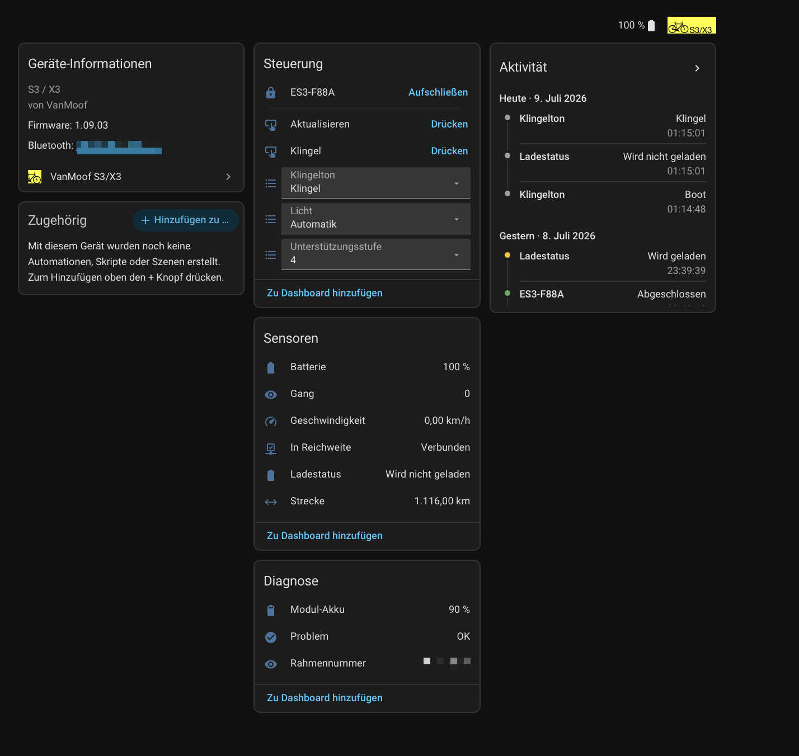

# VanMoof S3/X3 — Home Assistant integration

[](https://github.com/BobMcGlobus/ha-vanmoof/actions/workflows/validate.yml)
[](https://hacs.xyz)
[](https://github.com/BobMcGlobus/ha-vanmoof/releases)

A **standalone** HACS custom integration for the VanMoof S3/X3, talking to the
bike directly over BLE from Home Assistant — no Pi bridge, no MQTT layer.

It exposes:

- `sensor.*` — battery %, odometer (km, total_increasing), current speed (km/h),
  current gear, plus diagnostics: module (anti-theft) battery %, frame number
- `lock.*` — the bike's digital lock (lock / unlock; locking connects immediately)
- `binary_sensor.*` — **In range**: passive presence from BLE advertisements
  (any adapter/proxy), so it flips off shortly after the bike leaves range —
  handy for arrival and departure / theft automations, independent of polling.
  **Charging**: on while the main battery is charging. **Problem**: on when the
  bike reports an error.

- `button.*` — **Refresh**: forces an immediate poll instead of waiting for the
  interval (stays pressable even when the bike is currently unavailable).
  **Bell**: rings the bell/horn (opens a BLE session, so a few seconds' delay).
- `select.*` — **Assist level** (0-4), **Light** (off/auto/on), **Bell tone**
  (bell/boat/party).

Device info carries the frame number (serial), model, and firmware version.

The **poll interval** is adjustable per bike (integration → *Configure*). A wrong
encryption key triggers a **re-authentication** prompt instead of a silent retry
loop.

Under the hood it wraps a vendored slice of
[`pymoof`](https://github.com/quantsini/pymoof) and uses Home Assistant's own
Bluetooth stack (`bleak-retry-connector`), so the connection is routed
automatically through the **local adapter or any ESPHome Bluetooth proxy** that
can currently reach the bike. Setup can pull the encryption key straight from
your VanMoof account; after that it's fully local.

Translations: English, German, Dutch.

## Screenshots



## Supported hardware

- ✅ **VanMoof S3 / X3** — supported and tested on real S3 hardware.
- ❔ **Other bikes:** the S3/X3 BLE protocol (via pymoof) is the only one
  implemented. SX1/SX2 and "Smart" S1/S2 are recognised over the air but *not*
  supported by pymoof; S5 / A5 use a different, unsupported protocol. Adding a
  model means adding a second BLE client — contributions welcome, but there's no
  untested "support" claimed here.

---

## Install

**HACS (custom repository)**
1. HACS → ⋮ → *Custom repositories* → add `https://github.com/BobMcGlobus/ha-vanmoof`, category *Integration*.
2. Install *VanMoof S3/X3*, restart HA.

**Manual**
Copy `custom_components/vanmoof/` into `<config>/custom_components/`, restart HA.

Then: *Settings → Devices & Services → Add Integration → VanMoof*, and pick one
of the two setup paths below.

---

## Setup: getting the encryption key + user key id

The integration needs two values per bike, an `encryptionKey` and a `userKeyId`.
It only needs them **once, at setup** — afterwards everything runs over Bluetooth
and the cloud is never contacted again.

The config flow offers two ways to supply them.

### 1. Log in with your VanMoof account

Convenient when it works: choose *"Log in with my VanMoof account"*, enter your
VanMoof email + password, pick the bike, and the keys are fetched for you.
Credentials are used once and not stored.

Be aware this depends on VanMoof's legacy `v8` API, which is visibly decaying
since the company changed hands (Lavoie). Its old host, `my.vanmoof.com/api/v8`,
no longer resolves at all; since **v0.16.3** the integration uses
`api.vanmoof-api.com/v8`, which serves the same API from VanMoof's own backend
(thanks [@computerd36](https://github.com/computerd36),
[#2](https://github.com/BobMcGlobus/ha-vanmoof/pull/2)). Older versions can't
log in anymore.

The API is also known to return a **stale bike list** — a recently added bike
missing while removed ones still appear — and at least one user got an **empty
list** from it, while the web account shows the correct bikes
([#1](https://github.com/BobMcGlobus/ha-vanmoof/issues/1)). Other key-export
tools reading the same `getCustomerData` endpoint are affected identically, so
reaching for a second one won't help. The newer web portal
(`www.vanmoof.com/my-vanmoof/…`) does list bikes correctly, but as far as I can
tell it doesn't expose the encryption keys at all, so it isn't a replacement.

**Already set up bikes are not affected by any of this.** Their keys live in the
config entry, and nothing re-fetches them.

### 2. Enter the key manually

The path that doesn't depend on VanMoof's servers, and the one to use if the
account login can't see your bike. Choose *"Enter the encryption key manually"*,
pick the bike from the nearby-device list (or paste its MAC), then enter the
`encryptionKey` (hex) and `userKeyId` (int), however you obtained them.

If your bike is missing from the account API, the key has to come from somewhere
else — note that
[`chwdt/vanmoof-tools`](https://github.com/chwdt/vanmoof-tools) is a
firmware-level reverse-engineering toolkit (dumping/patching bike firmware), not
a ready-made key exporter. If you know of a working way to read the key off an
S3 over BLE, please open an issue; it would make this integration a lot more
future-proof.

### Either way

The bike must be **in Bluetooth range and awake** during setup: the MAC stored in
your VanMoof account is *not* the address the bike advertises on, so the
integration connects using the address it actually sees over the air. Easiest
path is to let **auto-discovery** find an in-range bike and then supply the key.
A bike that's out of range (e.g. in the cellar) can't be set up until it's nearby.

---

## Status & known rough edges

Verified on real S3 hardware: account login, auto-discovery, connect →
authenticate → read, and the battery / odometer / speed sensors + lock entity.

Known rough edges:

- **The bike must be in range and awake when you add it** — the MAC in your
  VanMoof account is *not* the BLE address it advertises on, so the integration
  uses the address it actually sees over the air. Afterwards the entry loads even
  when the bike is away (entities show unavailable; presence and Refresh work).
- **It's a single-connection device.** If the phone app (or anything else) holds
  the connection, Home Assistant can't get in. After a lot of connect churn the
  bike's module can also get stuck — symptoms are GATT `error=14 Unlikely error`
  or `error=133` on every poll. The integration clears its service cache and
  retries automatically; if it stays stuck, wake/ride the bike or power-cycle it
  (and restart the ESPHome proxy if you use one).
- **Active ESPHome proxies**: an ESP32-S3/C3 is noticeably flakier than a classic
  ESP32 for *active* (connectable) proxying.
- **Icon needs HA ≥ 2026.3** — the integration ships its own brand images
  (`custom_components/vanmoof/brand/`); older HA shows a placeholder.

---

## Distance per day / week / month / year

The `distance` sensor is the bike's lifetime odometer (a `total_increasing`
total). To get *distance today / this week / month / year*, use Home Assistant's
built-in **Utility Meter** helper on it — that's the idiomatic, robust way
(handles cycle resets, restarts, and time zones for you; no template sensors to
maintain). The odometer keeps its last value when the bike is out of range, so
the meters don't get gaps.

**UI:** *Settings → Devices & Services → Helpers → + Create Helper → Utility
Meter* → input `sensor.<bike>_distance`, pick a reset cycle (Daily), create.
Repeat for Weekly, Monthly, Yearly.

**YAML** (`configuration.yaml`):

```yaml
utility_meter:
  vanmoof_distance_today:
    source: sensor.es3_f88a_distance   # your odometer entity
    cycle: daily
  vanmoof_distance_week:
    source: sensor.es3_f88a_distance
    cycle: weekly
  vanmoof_distance_month:
    source: sensor.es3_f88a_distance
    cycle: monthly
  vanmoof_distance_year:
    source: sensor.es3_f88a_distance
    cycle: yearly
```

Weekly resets Monday, monthly/yearly on the 1st by default (tunable per meter).

---

## Design notes / known trade-offs

- **Connect-per-poll.** Every 5 min: connect → `authenticate()` → read →
  disconnect. Politer to the bike than a persistent link (doesn't block the
  phone app, doesn't hold the radio), at the cost of a few seconds per cycle.
  If you want faster lock response or live speed, switch to a persistent
  connection + GATT notifications and drop the poll — the coordinator's
  `_with_client` is the single place to change.
- **`authenticate()` fails silently.** pymoof's `authenticate()` returns even
  on a bad key; the first read (`get_battery_level`) is what raises. A wrong key
  therefore currently surfaces as a repeating `UpdateFailed`/`ConfigEntryNotReady`
  retry loop rather than a clean auth error. If you want a reauth flow, raise
  `ConfigEntryAuthFailed` from `_with_client` on the first-read failure.
- **`pymoof` is vendored, not a requirement.** The published `pymoof` pins
  `bleak<0.15` and `cryptography<37`, which conflict with Home Assistant's own
  (much newer) versions — installing it makes HA's requirement step fail (a
  *"config flow could not be loaded: 500"*). So the small runtime slice of
  pymoof (SX3 client, GATT profile, BLE helpers) lives under
  `pymoof_vendor/` (MIT, upstream quantsini/pymoof) and uses HA's own `bleak`
  and `cryptography`. Nothing is pip-installed. To refresh it, re-copy those
  files from upstream and re-point the two package-internal imports.
- **Availability is automatic.** When the bike is out of range, the poll fails
  and all entities go `unavailable` via `CoordinatorEntity`. No extra code.
- **Idempotent setup.** `unique_id` is the MAC. Consider `get_frame_number()`
  (no auth needed) as a stabler unique id, and to validate the connection
  inside the config flow before creating the entry.
